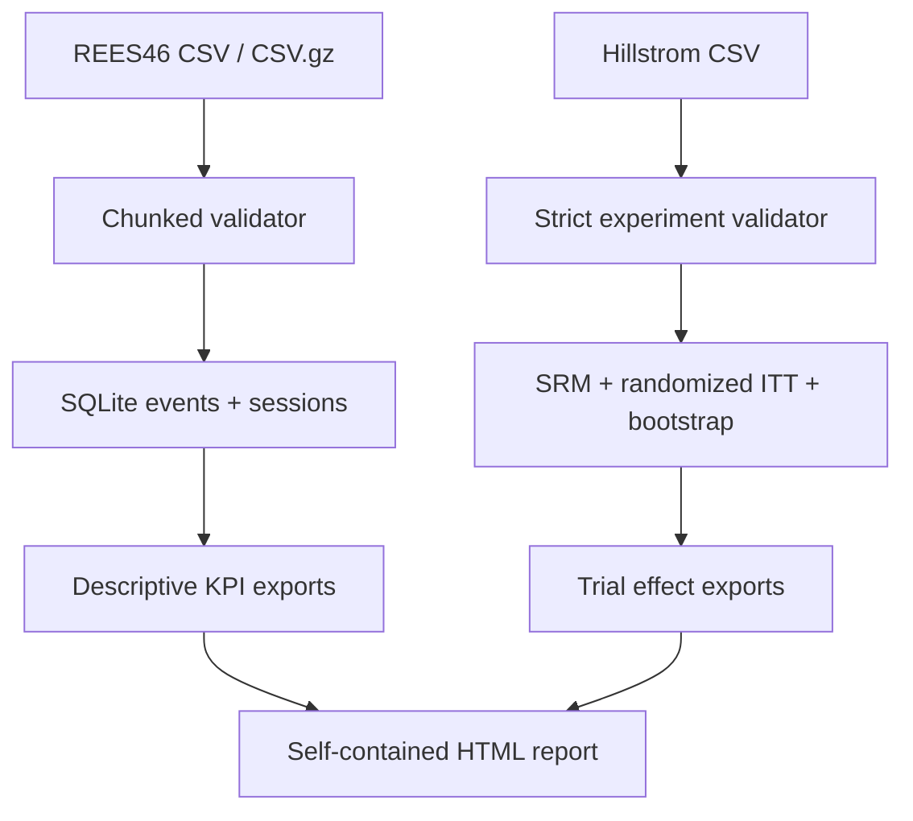

# E-commerce Experimentation & Customer Analytics

**Portfolio study for Data Analyst roles: SQL · Python · Funnel Analytics · Experimentation · Business Metrics**

An end-to-end reproducible analysis of two **independent** data sources:

1. **REES46 electronics store** — historical `view`, `cart`, `purchase` events; session conversion, product categories, time series and quality checks.
2. **Kevin Hillstrom / MineThatData (2008)** — a genuine, randomized 3-arm marketing experiment; difference in 2-week conversion, Holm multiplicity adjustment, revenue differences with bootstrap uncertainty and balance checks.

The two sources are unrelated to each other and identities cannot be joined. Historical e-commerce event analytics are descriptive; only randomized experiment data supports a causal intent-to-treat comparison of the original campaigns. Currency for REES46 is deliberately labelled "source units" until confirmed in the data documentation. No claim to platform margin or campaign profit is made.

## Quick start — Windows PowerShell

Requires Python 3.10+, an internet connection for package installation, and enough disk space for the source events + SQLite database.

```powershell
py -3.12 -m venv .venv
.\.venv\Scripts\python.exe -m pip install -e ".[dev]"
.\.venv\Scripts\python.exe -m ecommerce_analytics demo --output outputs/demo
```

Open `outputs/demo/index.html` in a browser. **This report is explicitly labelled SYNTHETIC DEMONSTRATION**, not a finding from REES46 or the original Hillstrom study.

### Run on original publicly available datasets

Download the two source files following [docs/data_sources.md](docs/data_sources.md). The official REES46 `.csv.gz` can be used without decompressing. Place files at the indicated paths, then:

```powershell
.\.venv\Scripts\python.exe -m ecommerce_analytics run `
  --events data/raw/electronics-events.csv.gz `
  --experiment data/raw/hillstrom.csv `
  --output outputs/real-001
```

Each run must use a fresh output directory. Missing or invalid source files stop execution with clear exceptions. Nothing quietly falls back to generated data in `run` mode.

### Linux/macOS

```bash
python3 -m venv .venv
source .venv/bin/activate
pip install -e '.[dev]'
python -m ecommerce_analytics demo --output outputs/demo
pytest -q
ruff check src tests
```

## What the pipeline produces

```text
outputs/<run>/
  index.html                          standalone HTML report (charts embedded)
  run_manifest.json                   run mode, local input and report paths
  funnel/
    events.sqlite                     normalized input rows and session view
    funnel_metrics.json               quality and KPI definitions
    monthly_sales.csv                 calendar-month revenue & purchasers
    category_sales.csv                ranked product-category revenue
  experiment/
    experiment_metrics.json           primary comparisons, CIs and caveats
    experiment_arms.csv               three-arm summary
    experiment_comparisons.csv        ITT estimates, spend effect, corrected p
    experiment_balance.csv            baseline standardized differences
```

## Architecture



## Scientific safeguards

- **Purchase events may be order items**; without order IDs we do not invent order count, AOV, refund-adjusted revenue, or margin.
- Session denominators exclude rows with unknown session IDs; unknown-session purchase value remains in event-level value.
- Session paths are reported separately from unordered event reach. Missing cart events are not treated as proven abandonment.
- Randomized comparisons retain the three original arms and use **two** predeclared conversion contrasts vs. control, with Holm adjustment.
- Spend differences are **per randomized customer** including zeros, rather than per buyer (post-treatment conditioning bias).
- No attempt to merge customers or make cross-dataset causal claims.
- Raw-source data is excluded from version control; source attribution and caveats are documented.

See [research protocol and KPI dictionary](docs/methodology.md) for formulas and limitations. See [sample SQLite analytical queries](sql/analytics.sql).

## Test and QA

```bash
pytest -q
ruff check src tests
```

GitHub Actions validates lint, unit/integration tests and a complete offline demo run. Demo generation is deterministic. A full real-data report requires the original source files; no real-data performance or business-effect claims are made before they are processed.

## Next extension — BI dashboard

The exported category, monthly and experiment CSVs, plus `events.sqlite`, form a semantic base for a Power BI dashboard. Recommended pages: Executive KPIs, Product Funnel, Sales by Category, Experiment Evaluation and Data Quality. Rebuild in Power BI using the documented KPI definitions, not inferred order counts.
